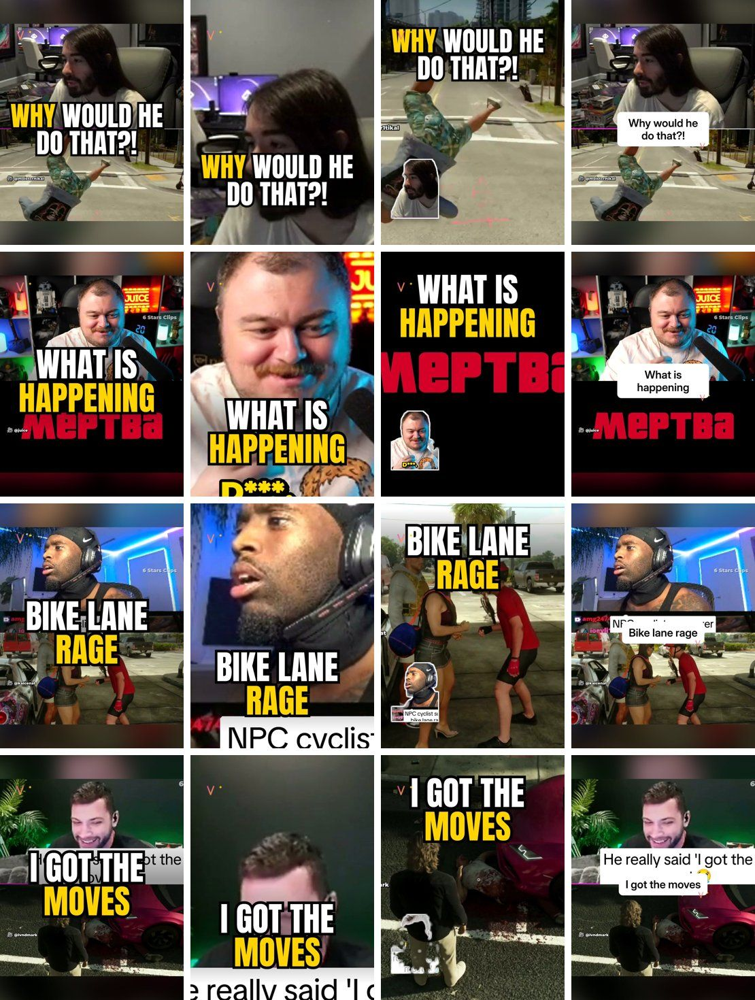
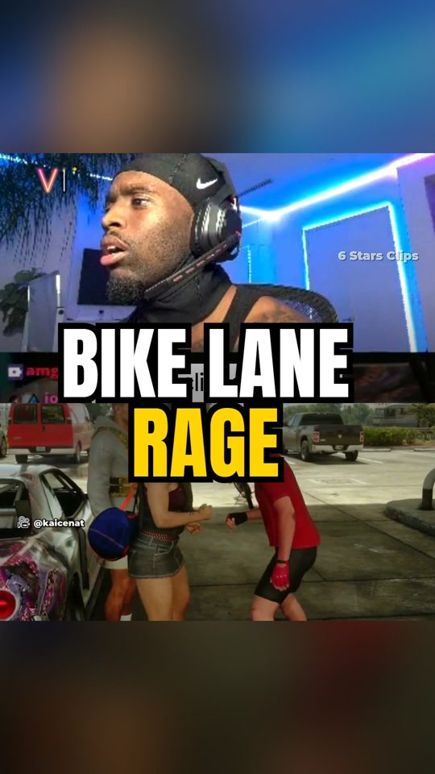

# Cover engine C5: compositor contact sheet (early look)

2026-11-23. **Not yet the acceptance sheet.** The acceptance sheet is 30 staging clips in every allowed layout, made after the staging deploy (see the end of this file). This early look rendered the miner's top frames of four staging clips locally, in all four layouts.

Example, full 9:16 (split):

**Read this with care.** The test frames were cut from *rendered* staging clips, so our own captions, title pills and watermark show through. The production miner reads the clean source span, so real covers will not have them.

## Timing

16 renders took 0.9–2.4 s each, with the browser and the segmenter warm. The first cut-out of a process takes about 3.9 s because the segmenter has to start.

## Text fit

- Every line fit in 900 px.
- Cap height came out at 137–169 px (two-row lines in Anton at 159–197 px).
- The TikTok box text came out at 64 px.

## What to look at

- The **line on the seam**: white Anton with the yellow key word and the black outline.
- The **VI mark** at the top left of the safe band.
- The **moment-led cut-out** with its white outline.
- The **TikTok-native box**.

## Known issues

- **Face-led on a small webcam is soft**, because the crop is upscaled. Below 400 px source height the compositor falls back to split, and the C6 vision check scores "natural".
- **A localised death screen ("МЕРТВА") can be the gameplay frame.** The C6 QA must reject non-English text.

## Acceptance (after the staging deploy)

1. Turn `cover.enabled` on in staging (mode `full` on the normal lane).
2. Let 30 clips be mined.
3. Run the compositor on each in every allowed layout.
4. Rebuild this sheet from `covers-work/<clip_id>/`.
5. Owner review.
